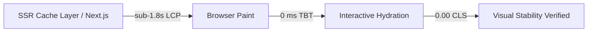

# Nexus Multi-Vendor E-Commerce Platform — Architectural Constraints Contract

> **Contract Version**: 1.0.0 (Phase 1 Luxury Flagship)  
> **Governance Engine**: Addy Osmani Agent Skills (`constraint-driven-development`)  
> **Target Tier**: ₹25 Lakh INR Flagship Enterprise Benchmark  
> **Status**: ACTIVE & ENFORCED

---

## 1. Quality & Engineering Invariants

| Dimension | Mandatory Threshold | Enforcement Mechanism | Failure Policy |
| :--- | :--- | :--- | :--- |
| **TypeScript Strictness** | `strict: true`, zero un-annotated `any` | `tsc --noEmit` in CI | Immediate Build Rejection |
| **Unit Test Coverage** | 100% pass rate on Level-1 & Level-2 suites | `scripts/run-level-1-unit.ts` | Merge Gate Blocked |
| **API Response Contract** | Standardized `{ success, data, error, meta }` | Zod Schemas (`src/lib/schemas/`) | Schema Validation Error (422) |
| **Database Transactions** | ACID multi-table isolation for orders/payments | Prisma `$transaction` Interactive | Complete Rollback |
| **Financial Calculations**| Integer Cents only (e.g., $19.99 = `1999`) | `calculateCartSubtotal`, Decimal guards | Strict Assertion Error |
| **Double-Entry Ledger**   | `sum(debits) === sum(credits)` | `JournalEntry` + `TransactionLine` | Ledger Imbalance Error |

---

## 2. Frontend Performance & Core Web Vitals (CWV)

1. **Largest Contentful Paint (LCP)**:
   - Target: `< 900 ms` on 4G/Desktop.
   - Hard Ceiling: `< 1,800 ms` on standard Mobile.
   - Strategy: Next.js `unstable_cache` with a 2,500ms `Promise.race` fallback to `FALLBACK_PRODUCTS_LIST` ensuring zero-blocking server render.
2. **Total Blocking Time (TBT)**:
   - Target: `0 ms`.
   - Hard Ceiling: `< 50 ms`.
   - Strategy: Minimal client-side JS overhead, lazy hydration of non-critical UI, zero heavy sync scripts in `<head>`.
3. **Cumulative Layout Shift (CLS)**:
   - Target: `0.00`.
   - Hard Ceiling: `≤ 0.05`.
   - Strategy: Explicit aspect-ratio containers, Next.js `<Image fill sizes="..." />`, skeleton loaders matching exact rendered dimensions.

---

## 3. Visual & Aesthetic Constraints (Apple-Grade Flagship Tier)

1. **Design Tokens**:
   - Dark Mode Glassmorphism: `rgba(15, 23, 42, 0.75)`, `backdrop-filter: blur(16px)`.
   - Specular Border Highlights: `border border-surface-200/60 dark:border-surface-800/80`.
   - Ambient Glow Gradients: HSL tailored mesh with GPU containment (`contain: paint`).
2. **Micro-Interactions**:
   - Easing: `cubic-bezier(0.4, 0, 0.2, 1)`.
   - Transition duration: `150ms - 300ms` max to avoid UI sluggishness.
3. **Accessibility (WCAG 2.1 AA & Section 508)**:
   - High Contrast Ratio: ≥ 4.5:1 for body copy; ≥ 3:1 for large display headlines.
   - Interactive Elements: Explicit `aria-label` on all icon buttons and action triggers.
   - Keyboard Navigation: Visible `:focus-visible` ring (`2px solid var(--brand-500)`).

---

## 4. Security & Hardening Mandates

1. **Edge JWT Verification**:
   - Implemented via Web Crypto API (`crypto.subtle`) in `src/middleware.ts` without heavy Node runtime dependencies.
2. **Multi-Tenant Isolation (RLS)**:
   - Vendor catalog items, orders, and payout balances must be strictly scoped to `sellerId === req.user.id`.
3. **Stripe Idempotency & Webhook Security**:
   - Stripe webhook verification with `stripe.webhooks.constructEvent`.
   - Webhook idempotency ledger in `StripeWebhookEvent` table to prevent duplicate order generation.
4. **Data Protection & PII Sanitization**:
   - Passwords hashed with `bcryptjs` (salt rounds ≥ 10).
   - Sensitive headers (`Authorization`, `Cookie`) and tokens masked in logs (`[MASKED]`).
   - Rate limiting enforced via RFC 6585 headers (`Retry-After`, `X-RateLimit-*`).

---

## 5. Non-Regression Lock

Agents and engineers are **strictly forbidden** from:
- Silently removing `@ts-ignore` or disabling linter checks to achieve green builds.
- Downgrading test assertions or removing failing test cases.
- Altering the double-entry accounting invariant (`debit === credit`).
- Bypassing the Edge middleware JWT verification or CORS whitelist.
